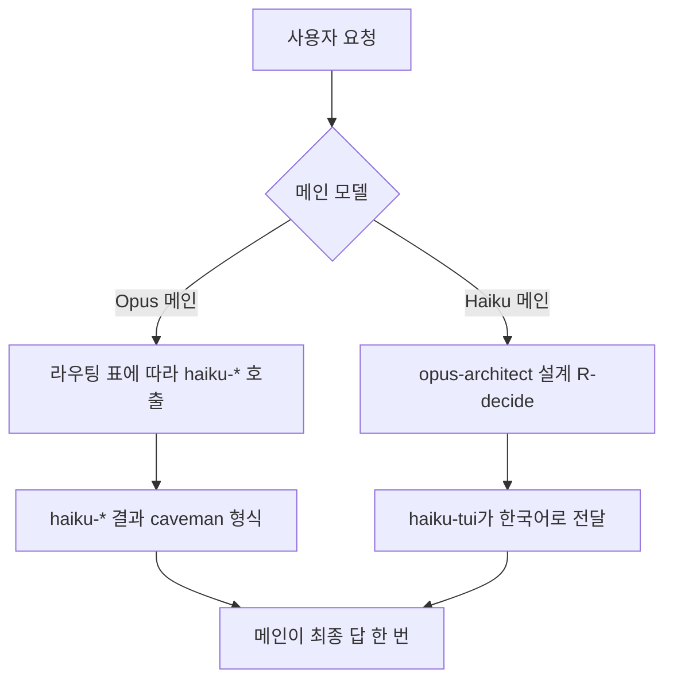

# 모델과 에이전트

이 문서는 claude-harness가 어떤 모델을 쓰고, 어떤 에이전트에 일을 나누는지 설명합니다.

## 1. 모델 구분

기본 모델은 Opus입니다. 대화를 맡는 메인 세션이 Opus로 돌아가며, 판단하고 일을 나눕니다. Opus 메인은 파일을 직접 읽거나 쓰지 않고, 웹을 검색하거나 Bash를 실행하지도 않습니다. 이 제한은 훅이 강제합니다. 실제 작업은 모두 Haiku 에이전트가 합니다.

Haiku를 메인으로 쓰고 싶으면 `--model haiku`로 시작하거나, 대화 중에 "haiku로"라고 말씀하시면 됩니다. 이 경우 흐름이 달라집니다. 사용자의 말을 그대로 `opus-architect`에 넘기면, 설계 결과를 `haiku-tui`가 한국어로 옮겨 답합니다. 기본 흐름에서는 Sonnet을 쓰지 않습니다. 다만 설정 피커의 `main_model`을 sonnet 또는 fable로 고르면 그 모델이 메인이 됩니다. 라우터도 없습니다. 언제든 "opus로"라고 말씀하시면 Opus 메인으로 돌아갑니다.

## 2. 이름 규칙

에이전트 이름에는 모델 이름이 들어갑니다. `haiku-*`는 Haiku로 돌고, `opus-*`는 Opus로 돕니다. 이름만 봐도 어떤 모델이 일하는지 알 수 있습니다.

호출할 때 `model` 값을 따로 넘겨도 `agent-model-pin.py`가 그 값을 지웁니다. 모델은 이름이 정합니다.

## 3. 에이전트 표

에이전트는 모두 11개입니다. 역할 묶음은 조회, 작성, 검증, 실행, 설계, 대화 순서로 나눴습니다.

| 에이전트 | 모델 | 역할 묶음 | 언제 씁니까 | 도구 |
|---|---|---|---|---|
| haiku-scout | Haiku | 조회 | 파일 위치, 예전 대화 내용을 찾을 때 | Read, Grep, Glob, Bash |
| haiku-researcher | Haiku | 조회 | 웹에서 자료를 찾고 출처를 붙일 때 | WebSearch, WebFetch, Read, Write |
| haiku-extractor | Haiku | 조회 | 긴 대화를 나눈 조각에서 사실, 결정, 산출물, 미결 사항을 뽑을 때 | Read, Write, Grep, Glob |
| haiku-drafter | Haiku | 작성 | 사용자 말투로 글을 쓰거나 고칠 때 | Read, Write, Edit, Bash, Grep, Glob |
| haiku-batch-worker | Haiku | 작성 | 형식 변환, 폴더 정리, 일괄 치환, 나누기와 합치기를 할 때 | Read, Write, Edit, Bash, Glob, Grep |
| haiku-coder | Haiku | 작성 | 범위가 좁은 코드 수정과 버그 수정을 할 때 | Read, Write, Edit, Bash, Grep, Glob |
| haiku-checker | Haiku | 검증 | 바꾼 내용이 맞는지 읽기 전용으로 확인할 때 | Read, Grep, Glob, Bash |
| haiku-runner | Haiku | 실행 | 오래 걸리는 작업을 백그라운드로 돌리고 진행 상황을 볼 때 | Read, Write, Edit, Bash, Grep, Glob |
| haiku-prompter | Haiku | 대화 | 반복, 재귀, N번, "될 때까지" 같은 루프를 맡을 때 | Agent, Read, Bash |
| haiku-tui | Haiku | 대화 | 에이전트 결과를 한국어 존댓말 답변으로 바꿀 때 | Read |
| opus-architect | Opus | 설계 | 설계와 판단을 하고, 작업을 `haiku-*`에 나눠 줄 때 | Agent |

`haiku-prompter`는 메인 스레드에서만 부를 수 있습니다. 에이전트가 다른 에이전트를 재귀로 부르는 것을 막기 위해서입니다. `opus-architect`도 Opus 에이전트를 부르지 않습니다. 설계와 위임만 하고, 파일에 직접 접근하지 않습니다.

## 4. 라우팅 지도

Opus 메인은 요청을 받으면 아래 표에 따라 `haiku-*`에 일을 나눕니다. 판단이 필요한 설계는 Opus 메인이 직접 정하고, Haiku 메인일 때는 `opus-architect`에 넘깁니다.

| 요청 종류 | 보내는 곳 |
|---|---|
| 찾기, 검색 | haiku-scout |
| 웹 자료 | haiku-researcher 또는 `/research` |
| 글쓰기 | haiku-drafter |
| 확인 | haiku-checker 또는 `/check` |
| 대량 작업, 노트 정리 | haiku-batch-worker |
| 작업 진행 상황 | haiku-runner 또는 `/status` |
| 코드 | haiku-coder |
| 설계, 판단 | Opus 메인이 직접 결정 (Haiku 메인이면 opus-architect) |
| 최종 확인 | haiku-checker |
| 사용자에게 보내는 답 | haiku-tui |
| 반복, 루프 | haiku-prompter (메인 스레드에서만) |

## 5. 한 번의 위임 흐름

사용자가 요청을 보내면 한 번의 위임 라운드가 돕니다. 필요한 에이전트 호출은 한 메시지에 모두 담고, 포그라운드로 실행합니다. 에이전트끼리 메인을 거치지 않고 체인을 잇지 않습니다. 결과를 받으면 메인이 답을 한 번 씁니다. 그다음 다시 대기합니다.

답변은 어떤 경로를 탔는지 밝히는 태그로 시작합니다. 예를 들면 `[haiku-scout]`처럼 씁니다.

## 6. 작업 요청 형식 (brief)

메인이 에이전트에게 일을 맡길 때는 brief를 씁니다. brief에는 `task`, `paths`, `ctx`, `limits`, `return`, `lang` 항목이 있습니다. 항목이 비어 있으면 `-`로 적습니다.

## 7. 반환 형식

에이전트는 짧은 형식으로 결과를 돌려줍니다. 이 형식을 caveman 형식이라고 합니다. 자세한 규칙은 `docs/claude-lean/CAVEMAN_FORMAT.md`에 있습니다. 모든 형식은 맨 위에 두 줄짜리 상태 머리글을 둡니다. 상태는 `status`와 `reason` 두 줄입니다.

- **R-read**: 찾은 내용을 돌려줍니다. 주요 항목은 `claim`, `searched`, `not_found`, `not_checked`, `truncated`, `omitted`, `summary_ko`입니다. 찾지 못한 것과 확인하지 않은 것은 따로 적습니다.
- **R-write**: 쓴 결과를 돌려줍니다. 주요 항목은 `changed`, `diffstat`, `check`, `ws`, `summary_ko`입니다.
- **R-decide**: 설계 결과를 돌려줍니다. 주요 항목은 `decision`, `why`, `rejected`, `risks`, `open_q`, `plan_path`, `summary_ko`입니다.
- **check**: 확인 결과를 돌려줍니다. 실패한 항목을 먼저 보여 주고, 전체 표는 `notes/runs/`에 저장합니다.

짧게 줄여도 경로, 줄 번호, 확실성 표시는 지우지 않습니다. 찾지 못함과 확인하지 않음은 합치지 않습니다. 한국어 값은 번역하지 않습니다.

## 8. 언어 정책

모든 에이전트 정의, 규칙, 반환 값은 영어로 씁니다. 한국어로 말하는 곳은 `haiku-tui` 하나뿐입니다. `haiku-tui`는 caveman 결과를 한국어 존댓말 답으로 바꾸고, 사실을 더하지 않습니다. 불확실한 표현은 `[likely]`는 "(추정)", `[unsure]`는 "(불확실)"로 옮깁니다.

## 9. 재개 상주 코더

`chaude`를 실행하면 몇 개의 세션이 상주합니다. 메인, 프롬프터, tui, 코더 네 슬롯이 기본입니다.

- **main**: 활성 대화 세션입니다. 메인 모델로 돕니다.
- **prompter**: 루프 규칙을 내장한 Haiku 세션입니다. 도구가 없습니다.
- **tui**: `haiku-tui` 역할을 맡습니다. 도구, MCP, 스킬이 없습니다.
- **coder**: `haiku-coder` 역할을 맡습니다. 도구는 Read, Edit, Write, Bash, Grep, Glob입니다.

중요한 파일을 고칠 때는 메인이 `resident_coder` 도구로 코더를 부릅니다. 코더가 바쁠 때만 목록에 보입니다. 코더가 더 필요하면 coder2부터 coder9까지 필요할 때 띄우며, 270초 동안 쉬면 내립니다. 상주 슬롯이 꺼지면 한 번 다시 띄웁니다.

## 10. notes/ 상태 파일

상태는 파일에 둡니다. 대화가 길어져도 파일을 보면 이어갈 수 있습니다.

| 경로 | 내용 |
|---|---|
| notes/FACTS.md | 확인된 사실 (에이전트가 읽는 기준) |
| notes/DECISIONS.md | 정한 결정 (에이전트가 읽는 기준) |
| notes/DELIVERABLES.md | 만든 산출물 목록 |
| notes/OPEN.md | 아직 정하지 않은 항목 |
| notes/LESSONS.md | 배운 점과 실수 |
| notes/runs/ | 백그라운드 작업 결과, 계획, 확인 표 (인계용) |
| notes/distill/ | 긴 대화를 나눈 조각과 추출 결과 |
| notes/research/ | 웹 조사 결과 |
| record/ | 훅이 쓰는 기록: LEDGER.md, INBOX.md, pastes/, metrics/ |
| logs/*.status | 작업 진행 상황 |
| logs/history/ | 대화 기록 내보내기 |
| .chaude/history.jsonl | 대화 기록 (검색용) |

## 11. 모델 가격

가격은 `notes/FACTS.md`에 있습니다. 단위는 USD/MTok이고, 열 순서는 입력, 5분 캐시 쓰기, 1시간 캐시 쓰기, 캐시 읽기, 출력입니다.

- Opus 5.5: 4 / 5 / 8 / 0.20 / 20
- Haiku 5.5 (100k 이하): 0.10 / 0.125 / 0.20 / 0.01 / 0.50

Haiku 5.5는 100k를 넘으면 가격이 올라갑니다. 자세한 값은 FACTS 파일을 보십시오.
